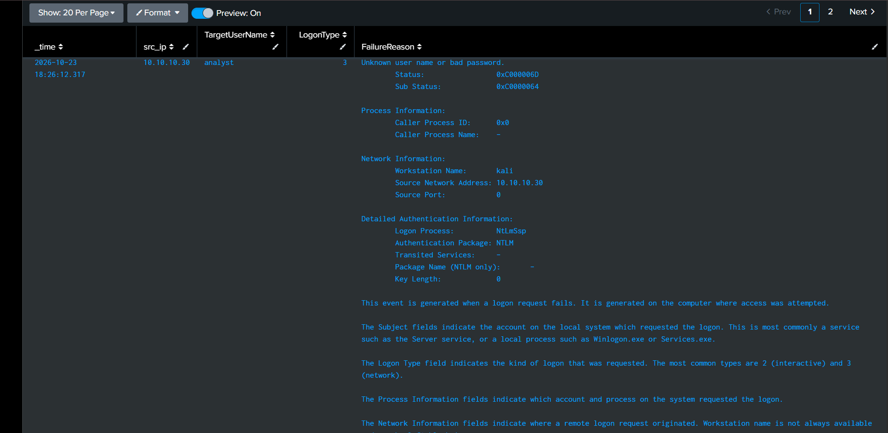
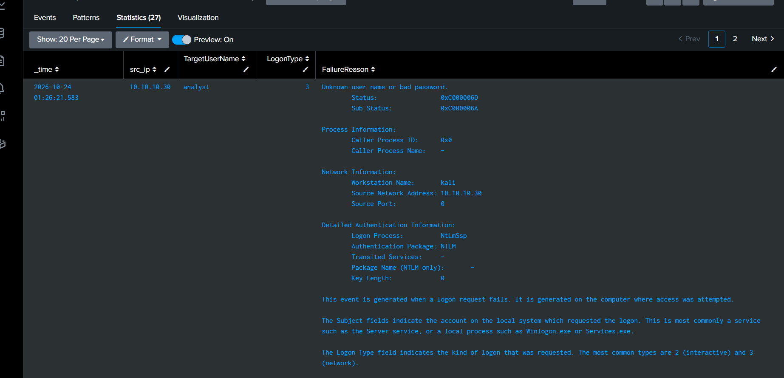
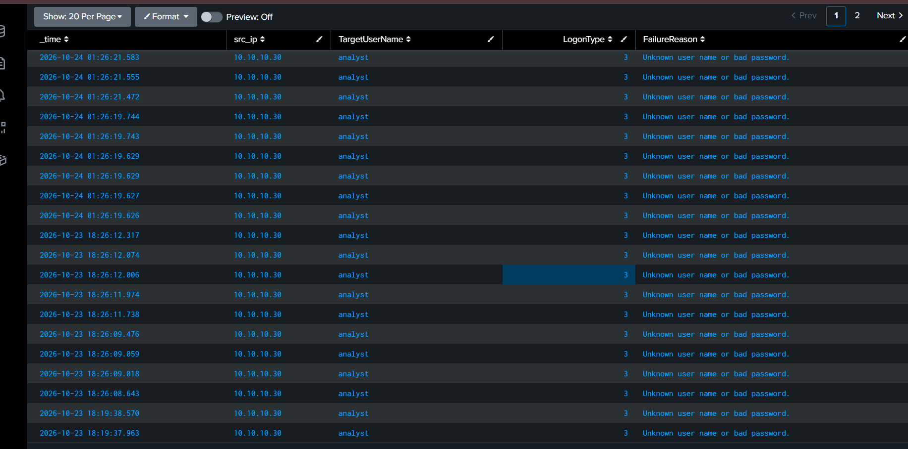

# Phase 1 - Task 1 - Activity 1: Log-Based Authentication Anomaly Triage

## Attack Simulation

Simulated an RDP brute-force attack from Kali Linux (10.10.10.30) against a Windows 11 IoT LTSC endpoint (10.10.10.20) using Hydra in an isolated VirtualBox lab environment.

**Attack command:**

hydra -l analyst -P passwords.txt 10.10.10.20 rdp -t 4 -vV


**Purpose:** Generate realistic failed authentication logs to practice SOC triage, detection, and MITRE ATT&CK mapping in Splunk.

## Detection - Splunk Queries

**Basic failed logon search:**

index=main source="WinEventLog:Security" EventCode=4625
| table _time, src_ip, TargetUserName, LogonType, FailureReason
| sort -_time


**Field extractions added to props.conf on Splunk server:**

[WinEventLog:Security]
EXTRACT-target_user = Account For Which Logon Failed:\s+Security ID:\s+\S+\s+Account Name:\s+(?<TargetUserName>[^\s]+)
EXTRACT-src_ip = Source Network Address:\s+(?<src_ip>[^\s]+)
EXTRACT-logon_type = Logon Type:\s+(?<LogonType>\d+)
EXTRACT-failure_reason = Failure Reason:\s+(?<FailureReason>.+)

## Brute-Force Identification

**Pattern identified:**
- 9 failed login attempts from a single source IP (10.10.10.30) within seconds
- All targeting the same username: `analyst`
- Logon Type 3 (network authentication via NTLM)
- Authentication Package: NtLmSsp (NTLM)
- Workstation Name: `kali`

**Threshold rule:** 5 or more failed login attempts from the same source IP within 10 minutes = BRUTE_FORCE

**Sub Status code analysis:**
- `0xC0000064` - username does not exist on the target system
- `0xC000006A` - username exists but password is incorrect

The first round of attacks returned Sub Status `0xC0000064` (unknown user). After creating the `analyst` account on the Windows endpoint, subsequent attacks returned `0xC000006A` (wrong password), confirming the account existed and was being password-guessed.

## MITRE ATT&CK Mapping

| Field | Value |
|-------|-------|
| Tactic | Credential Access (TA0006) |
| Technique | Brute Force (T1110) |
| Sub-Technique | Password Guessing (T1110.001) |
| Data Source | Windows Event Log — EventCode 4625 |
| Detection | Threshold-based alert on failed logons per source IP |

## Python Triage Script

Script: `auth_triage.py`

**Logic:**
1. Reads the raw Splunk CSV export (`auth_triage_raw.csv`)
2. Counts failed logins per source IP using Python's `Counter`
3. Applies SHA-256 hashing to usernames - in a production SOC, raw usernames are PII and must be masked in reports shared outside the team
4. Classifies each event:
   - **BRUTE_FORCE** - 5+ failures from same IP
   - **SUSPICIOUS** - 3-4 failures from same IP
   - **BENIGN** - under 3 failures
5. Tags BRUTE_FORCE and SUSPICIOUS events with MITRE technique T1110.001
6. Outputs enriched CSV (`Phase1_Task1_Activity1_AuthTriage.csv`)

**SHA-256 masking example:**
- Input: `analyst`
- Output: `f44ceb062e35dfee` (first 16 chars of SHA-256 hash)

## Threat Intelligence Cross-Reference

Script: `threat_intel_check.py`

**Purpose:** Cross-reference attacker IPs against AlienVault OTX threat intelligence feed (used as a lightweight MISP substitute for the lab environment).

**Logic:**
1. Takes attacker IPs identified during triage
2. Queries the OTX AlienVault API for each IP
3. Checks pulse count (number of security reports mentioning this IP)
4. Returns country of origin and reputation score
5. Outputs results to `threat_intel_results.csv` and `threat_intel_results.json`

**Results:**
- IP `10.10.10.30` returned 0 pulses — expected since this is a private lab IP
- In a production SOC, public attacker IPs would return real threat data showing prior attack history, associated campaigns, and known malware families

**Why this matters:**
- A SOC analyst doesn't just detect and block — they check if the attacker is a known threat
- 0 pulses = possible new attacker or compromised machine, needs further investigation
- High pulse count = known malicious infrastructure, escalate immediately
- This step informs the severity level and response priority in the incident ticket

## Incident Escalation - TheHive (Documented)

In a production SOC, confirmed brute-force attacks would be escalated to a case management platform like TheHive. Due to lab resource constraints, this escalation is documented rather than executed.

**TheHive API escalation payload:**
```json
{
    "title": "Brute Force from 10.10.10.30",
    "description": "RDP brute-force attack detected. 9 failed login attempts targeting 'analyst' account from Kali Linux (10.10.10.30) within seconds. NTLM authentication, Logon Type 3. Sub Status 0xC000006A confirms valid username with wrong passwords. MITRE ATT&CK T1110.001.",
    "severity": 2,
    "tlp": 2,
    "tags": ["T1110.001", "brute-force", "RDP"],
    "owner": "analyst",
    "flag": false,
    "status": "Open"
}
```

**Escalation workflow:**
1. SOC L1 analyst detects brute-force via Splunk alert
2. Validates findings - confirms source IP, target account, attack pattern
3. Cross-references IP against threat intel (OTX/MISP)
4. Creates a case in TheHive with severity, MITRE tags, and evidence
5. Attaches triage CSV and threat intel results as observables
6. Assigns to L2 for further investigation and response
7. L2 decides on IP block, account lockout, and broader scope check

## Verdict and Recommended Response

**Verdict:** BRUTE_FORCE - confirmed password guessing attack

**Recommended actions:**
1. Block source IP 10.10.10.30 at the perimeter firewall immediately
2. Force password reset for the targeted `analyst` account
3. Enable account lockout policy (e.g., lock after 5 failed attempts for 30 minutes)
4. Create a Splunk alert: trigger when EventCode 4625 count > 5 from a single IP within 10 minutes
5. Investigate whether the attacker gained access - search for EventCode 4624 (successful logon) from the same source IP
6. Cross-reference the source IP against threat intelligence feeds

## Lab Environment

| Machine | OS | IP Address | Role |
|---------|-----|------------|------|
| Ubuntu | Ubuntu Linux | 10.10.10.10 | Splunk server (SIEM) |
| Windows | Windows 11 IoT LTSC | 10.10.10.20 | Target endpoint |
| Kali | Kali Linux | 10.10.10.30 | Attacker |

## Files
- `auth_triage.py` — brute-force triage and classification script
- `auth_triage_raw.csv` — raw Splunk export
- `Phase1_Task1_Activity1_AuthTriage.csv` — enriched triage output
- `bruteforce_on_unknown_username.csv` — first attack round (unknown user)
- `threat_intel_check.py` — OTX threat intelligence lookup script
- `threat_intel_results.csv` — threat intel output
- `threat_intel_results.json` — full API response

## Screenshots



